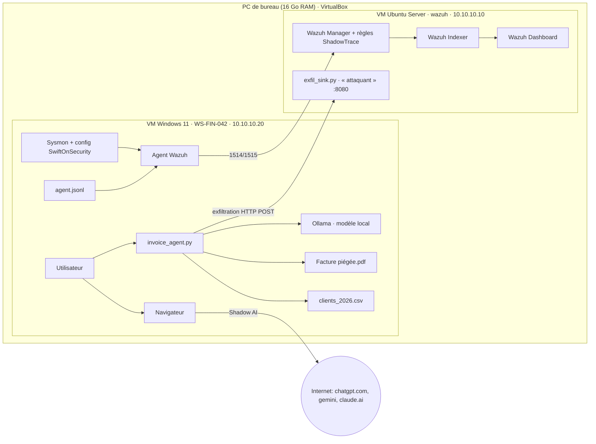

# ShadowTrace

**Détecter le Shadow AI et enquêter sur un agent IA détourné, de bout en bout, dans un lab SOC reproductible.**

> Projet portfolio Blue Team / Purple Team (DFIR · Détection · Sécurité de l'IA).
> Tout le lab est versionné ici (« lab as code ») : on clone, on lance les scripts, on rejoue l'attaque, on enquête.

---

## Le pitch en 30 secondes

Dans une entreprise, un comptable utilise des IA non autorisées (ChatGPT, Gemini) à côté de l'IA approuvée (Claude).
Il fait aussi tourner un petit **agent IA local** (Python + Ollama) qui résume automatiquement les factures reçues.
Un attaquant envoie une **facture piégée** : du texte invisible dans le PDF contient une **injection de prompt**.
L'agent obéit, lit le fichier clients et l'**exfiltre** vers un serveur externe.

ShadowTrace montre comment un SOC :

1. **voit** le Shadow AI et l'agent sur le poste (Sysmon) ;
2. **détecte** l'attaque avec des règles Wazuh écrites pour ce scénario ;
3. **enquête** (timeline, artefacts, IOC) et **mappe** l'incident sur MITRE ATT&CK et MITRE ATLAS ;
4. **rédige** un rapport d'incident (NIST SP 800-61) ;
5. **rejoue** l'incident dans une carte 3D interactive alimentée par les vraies alertes.

## Architecture



| Composant | Rôle | RAM |
|---|---|---|
| VM Ubuntu Server 24.04 | Wazuh 4.x en Docker *single-node* + serveur « attaquant » du labo | 5 Go |
| VM Windows 11 Enterprise (éval. 90 j) | Poste victime : Sysmon, agent Wazuh, Ollama, agent IA Python | 5 Go |
| Hôte (ton PC) | VirtualBox + navigateur pour le dashboard | ~6 Go restants |

Détails : [docs/architecture.md](docs/architecture.md).

> **Sécurité du lab :** l'exfiltration part vers une VM du labo (`exfil-relay.lab`), jamais vers Internet. Les données clients sont **100 % factices** (générées par script).

## Démarrage rapide (sur le PC de bureau)

| Étape | Où | Commande / doc |
|---|---|---|
| 0. Prérequis + VirtualBox + réseau du lab | Hôte | [docs/01-host-setup.md](docs/01-host-setup.md) · `infra/virtualbox/create-lab-network.ps1` |
| 1. VM Ubuntu + Wazuh | VM Ubuntu | `sudo bash infra/wazuh/install-wazuh-docker.sh` |
| 2. Règles ShadowTrace | VM Ubuntu | `sudo bash infra/wazuh/deploy-rules.sh` |
| 3. VM Windows : Sysmon | VM Windows (admin) | `.\infra\windows\01-install-sysmon.ps1` |
| 4. VM Windows : agent Wazuh | VM Windows (admin) | `.\infra\windows\02-install-wazuh-agent.ps1 -Manager 10.10.10.10` |
| 5. VM Windows : scénario (Ollama, Python, données) | VM Windows (admin) | `.\infra\windows\03-prepare-scenario.ps1` |
| 6. Rejouer l'attaque | Les deux VM | [scenario/RUNBOOK.md](scenario/RUNBOOK.md) |
| 7. Enquêter + rapport | Dashboard Wazuh | [reports/incident-report-template.md](reports/incident-report-template.md) |
| 8. Rejouer en 3D | Navigateur | `python tools/wazuh_to_3d.py` puis ouvrir `viz/shadowtrace-3d.html` |

Guide pas à pas complet : [docs/02-lab-build.md](docs/02-lab-build.md).

## Détections

| ID | Ce qui est détecté | Source | Niveau | Mapping |
|---|---|---|---|---|
| 100100 | Requête DNS vers une IA générative **non approuvée** | Sysmon 22 | 8 | ATT&CK T1567 · Shadow AI |
| 100101 | IA **approuvée** (Claude) : journalisée, pas d'alerte | Sysmon 22 | 3 | Liste blanche (anti faux positif) |
| 100110 | Démarrage d'un runtime LLM local (Ollama) | Sysmon 1 | 5 | ATLAS AML.T0040 (contexte) |
| 100111 | Process Python qui parle au LLM local (port 11434) | Sysmon 3 | 6 | Agent IA actif |
| 100120 | PDF déposé dans Downloads | Sysmon 11 | 5 | ATT&CK T1566.001 |
| 100121 | **Injection de prompt** dans une sortie d'outil de l'agent | Log agent JSON | 12 | ATLAS AML.T0051.001 |
| 100122 | L'agent lit un fichier sensible (Finance/clients) | Log agent JSON | 10 | ATLAS AML.T0053 · ATT&CK T1005 |
| 100130 | Python résout un domaine hors liste blanche | Sysmon 22 | 10 | ATT&CK T1071.001 |
| 100131 | Python : connexion sortante vers une IP non locale | Sysmon 3 | 10 | ATT&CK T1041 |
| 100140 | **Corrélation** : injection + exfiltration en < 5 min | Corrélation | 15 | ATLAS AML.T0086 · ATT&CK T1567 |

Règles : [rules/shadowtrace_rules.xml](rules/shadowtrace_rules.xml) · Mapping complet : [docs/mitre-mapping.md](docs/mitre-mapping.md).

## Structure du repo

```
shadowtrace/
├── docs/                  # architecture, installation, plan, mapping MITRE
├── infra/
│   ├── virtualbox/        # réseau du lab (PowerShell, sur l'hôte)
│   ├── wazuh/             # install Wazuh Docker + déploiement des règles (VM Ubuntu)
│   └── windows/           # Sysmon, agent Wazuh, préparation du scénario (VM Windows)
├── config/
│   ├── sysmon/            # ajouts ShadowTrace à la config SwiftOnSecurity
│   └── wazuh-agent/       # blocs ossec.conf (Sysmon + log de l'agent IA)
├── rules/                 # règles de détection Wazuh custom
├── scenario/
│   ├── agent/             # agent IA vulnérable (Python + Ollama)
│   ├── payloads/          # génération facture piégée + données factices
│   ├── attacker/          # serveur d'exfiltration du labo
│   ├── shadow-ai/         # génération du trafic Shadow AI
│   └── RUNBOOK.md         # rejeu de l'attaque pas à pas
├── tools/                 # export alertes Wazuh -> JSON pour la carte 3D
├── viz/                   # carte 3D interactive de l'incident
├── evidence/              # artefacts collectés (ignorés par git sauf README)
└── reports/               # modèle + rapport d'incident final
```

## Plan

Voir [docs/00-plan.md](docs/00-plan.md).

## Compétences démontrées

Ingénierie de détection (Sysmon, Wazuh, règles XML, corrélation) · Investigation endpoint Windows · Sécurité des agents IA (prompt injection indirecte, abus d'outils) · MITRE ATT&CK & ATLAS · Réponse à incident NIST 800-61 · Infrastructure as code · Visualisation d'incident.

## Avertissement

Projet pédagogique, à exécuter uniquement dans un lab isolé. Aucune donnée réelle, aucun domaine externe ciblé.
