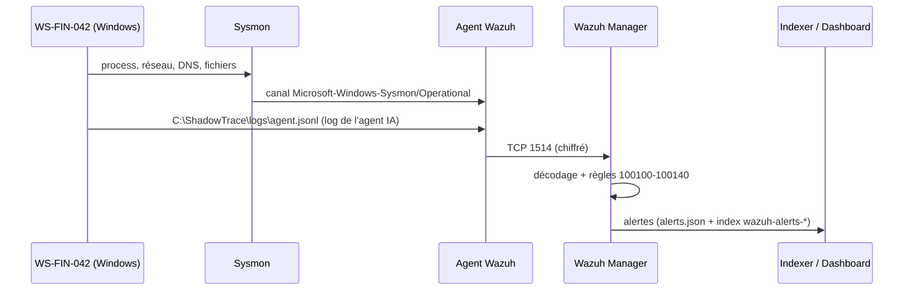

# Architecture du lab

## Vue d'ensemble

Deux VM sur VirtualBox, reliées par un **réseau NAT VirtualBox** (`shadowtrace-net`, `10.10.10.0/24`) :
elles se voient entre elles et ont accès à Internet (nécessaire pour le trafic Shadow AI vers chatgpt.com, gemini.google.com, claude.ai).

| Machine | Nom d'hôte | IP | OS | vCPU | RAM | Disque |
|---|---|---|---|---|---|---|
| Serveur SOC | `wazuh` | 10.10.10.10 (statique) | Ubuntu Server 24.04 LTS | 2 | 5 Go | 50 Go |
| Poste victime | `WS-FIN-042` | 10.10.10.20 (statique) | Windows 11 Enterprise (évaluation 90 j) | 2 | 5 Go | 64 Go |

L'hôte garde ~6 Go pour lui. Si ton PC rame : ferme le navigateur de l'hôte pendant les installations, et descends la VM Windows à 4 Go une fois Ollama testé.

## Pourquoi ces choix

| Choix | Pourquoi | Alternative |
|---|---|---|
| **VirtualBox** | Gratuit, marche sur Windows Home/Pro et Linux, gère le TPM 2.0 requis par Windows 11, snapshots faciles | Hyper-V (Windows Pro) ou KVM (hôte Linux) |
| **Wazuh en Docker single-node** sur Ubuntu | Reproductible (versionné, une commande), plus léger que l'OVA, on maîtrise la RAM de l'indexer | OVA officielle Wazuh (plus simple mais 8 Go par défaut, moins « as code ») |
| **Sysmon + config SwiftOnSecurity** | Standard du marché, bruit maîtrisé, on y ajoute nos inclusions IA | Config Olaf Hartong (modulaire, plus verbeuse) |
| **Petit modèle Ollama** (`qwen2.5:1.5b`) | Tient dans 5 Go de VM, suffisant pour l'agent | `llama3.2:3b` si la VM a 6 Go |
| **Exfiltration vers une VM du lab** | Rien ne sort vers Internet, scénario sûr | — |

## Flux de données

## Sources de télémétrie

| Source | Événements utiles | Pour détecter |
|---|---|---|
| Sysmon EID 1 | Création de processus | `ollama.exe`, `python.exe invoice_agent.py` |
| Sysmon EID 3 | Connexion réseau | python → 127.0.0.1:11434, python → IP externe |
| Sysmon EID 11 | Création de fichier | PDF dans `Downloads` |
| Sysmon EID 22 | Requête DNS | chatgpt.com, gemini.google.com, `exfil-relay.lab` |
| Log agent (JSON) | Appels d'outils, sorties d'outils | Injection de prompt, lecture de fichier sensible |

## Ports

| Port | Sens | Usage |
|---|---|---|
| 1514/tcp | Windows → Ubuntu | Événements agent Wazuh |
| 1515/tcp | Windows → Ubuntu | Enrôlement agent |
| 443/tcp | Hôte → Ubuntu (redirigé en 8443) | Dashboard Wazuh |
| 55000/tcp | Hôte/outil → Ubuntu | API Wazuh |
| 9200/tcp | Outil → Ubuntu | API Indexer (export vers la 3D) |
| 8080/tcp | Windows → Ubuntu | Serveur « attaquant » `exfil_sink.py` |
| 11434/tcp | local Windows | Ollama |
